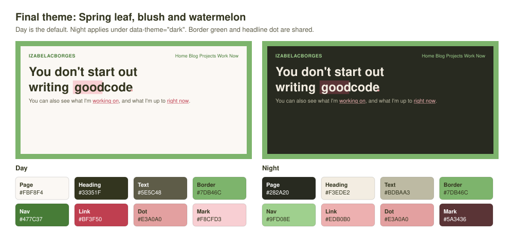
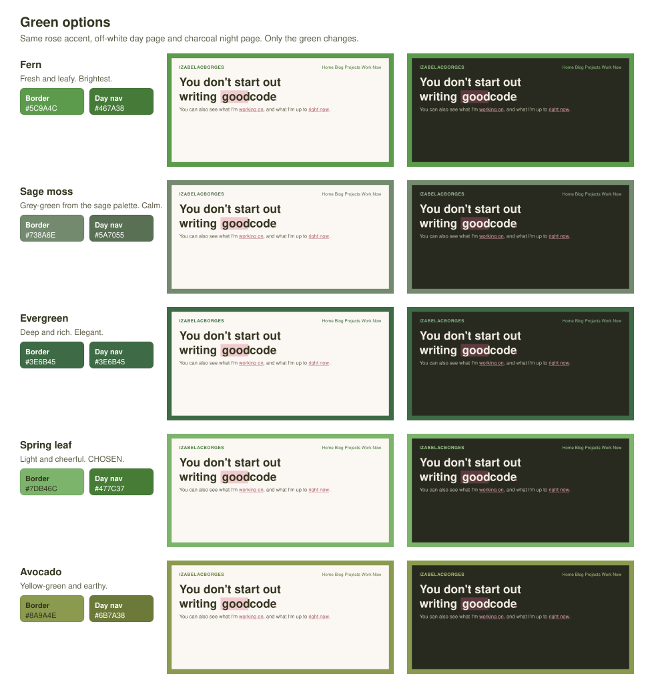
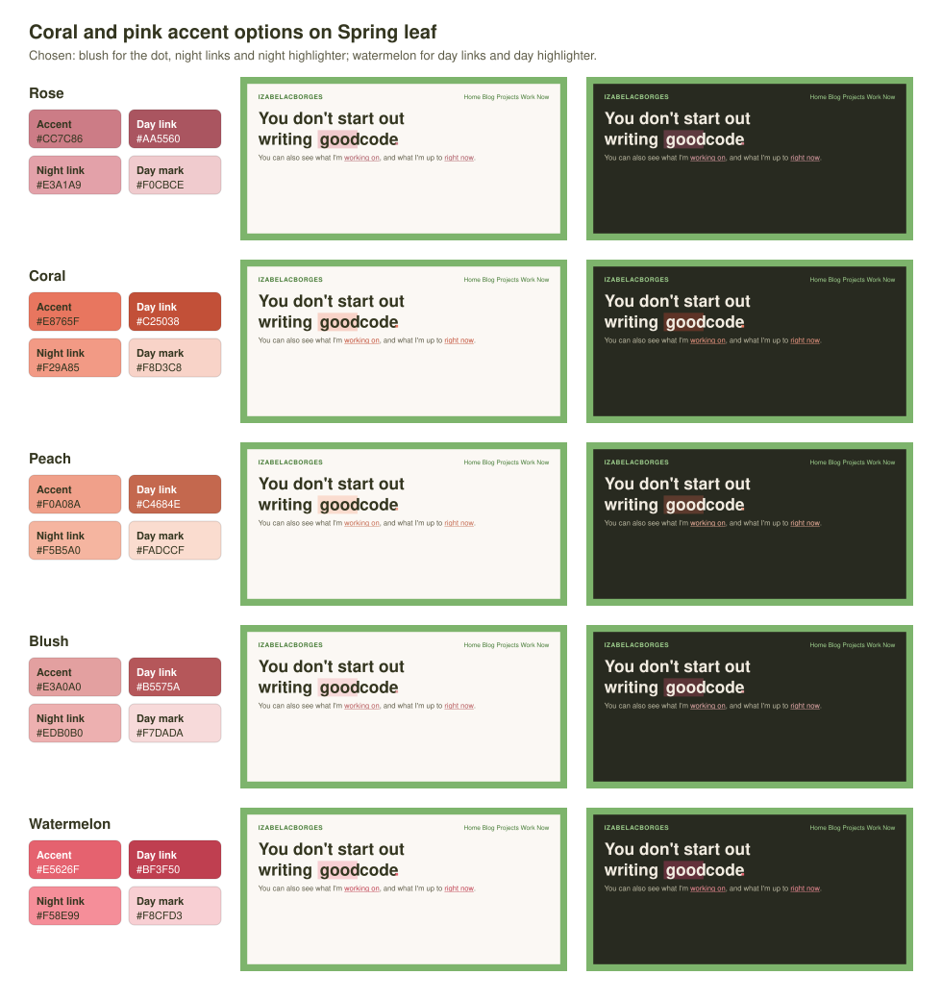
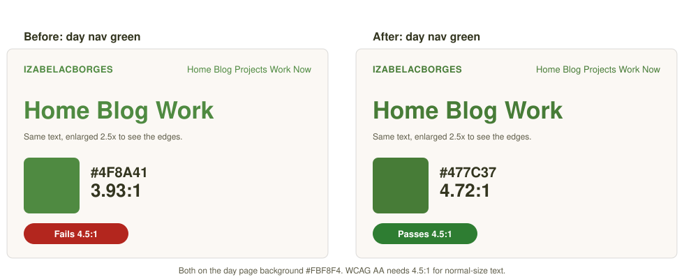

# Design

Design reference for izabelacborges.github.io. The goal: **clean and inviting, never boring.** Soft, earthy and green, with warm pink accents, personal rather than corporate.

Source of truth for values is [assets/scss/style.scss](assets/scss/style.scss). This document explains the *why*.

## Principles

- **Soft, not sterile.** Warm off-white instead of pure white; charcoal-olive instead of pure black.
- **Earthy and green.** The main colour is a fresh, leafy green. It frames every page.
- **One warm pop.** Pink and coral tones keep the green from going flat and give links and highlights personality.
- **Shared accents across modes.** The border green and the headline dot are identical in day and night, so the identity survives the switch.
- **No blue-green.** Greens lean yellow (fern, leaf, moss). Teal, aqua and forest-mist tones are out.
- **No mustard.** Warm accents are coral, pink and rose rather than yellow or gold.

## Final theme

**Names:** Spring leaf (green), blush (pink), watermelon (strong pink used on day).

### Day (default)

| Role | Variable | Value |
| --- | --- | --- |
| Page background | `--base-color` | `#FBF8F4` |
| Secondary surface | `--base-offset-color` | `#EFEAE0` |
| Headings | `--heading-color` | `#33351F` |
| Body text | `--text-color` | `#5E5C48` |
| Page frame (border) | `--frame-color` | `#7DB46C` |
| Logo and menu | `--nav-color` | `#477C37` |
| Links and accents | `--highlight-color` | `#BF3F50` |
| Link hover glow | `--light-highlight-color` | `#F8CFD3` |
| Heading dot | `--dot-color` | `#E3A0A0` |
| Word highlighter | `--mark-bg` / `--mark-text` | `#F8CFD3` / `#33351F` |
| Text on a highlight fill (pagination) | `--on-highlight-color` | `#FFFFFF` |

### Night (`:root[data-theme='dark']`)

| Role | Variable | Value |
| --- | --- | --- |
| Page background | `--base-color` | `#282A20` |
| Secondary surface | `--base-offset-color` | `#33362B` |
| Headings | `--heading-color` | `#F3EDE2` |
| Body text | `--text-color` | `#BDBAA3` |
| Page frame (border) | `--frame-color` | `#7DB46C` (same as day) |
| Logo and menu | `--nav-color` | `#9FD08E` |
| Links and accents | `--highlight-color` | `#EDB0B0` |
| Link hover glow | `--light-highlight-color` | `#5A3436` |
| Heading dot | `--dot-color` | `#E3A0A0` (same as day) |
| Word highlighter | `--mark-bg` / `--mark-text` | `#5A3436` / `#F3EDE2` |
| Text on a highlight fill (pagination) | `--on-highlight-color` | `#282A20` |

### Why the pairs differ between modes

- **Green nav text** is a deeper green on day (`#477C37`) and a lighter one at night (`#9FD08E`). The border green `#7DB46C` is too light for small text on the cream page and too dark to stand out as text on the night page, but it works well as a frame in both.
- **Links** are watermelon on day because blush was too faint on cream. At night they are blush, which reads well against charcoal.
- **Highlighter** follows the same split: watermelon tint on day, blush tint at night.
- **The dot** stays blush in both modes. It is decoration, not text, so contrast rules are looser.

## How we got here

The palette was chosen over several rounds. Rejected directions are recorded so they aren't re-proposed.

1. **Start:** white and lavender (`#CA9EE6`), chosen about three years ago. Wanted something softer, greener and earthier.
2. **Sage, forest and sand palettes.** Liked *Sage and clay* and *Fern and rose*, but found them too soft and a little boring.
3. **Bolder greens** from the vivid green swatch set and the sage monochrome set, with marigold, clay and rose accents. Disliked the vivid versions and the mustard accents more than the earlier round.
4. **Muted earthy palettes** (cocoa, olive, bone, herbal grove, blush root) with coral and pink. Liked *Herbal grove and blush* and *Moss and rose*, but not their dusty greens.
5. **Green options on a fixed rose base.** The green was the weak point. *Spring leaf* was the clear winner, with *Fern* a close second.

   

6. **Pink and coral options on Spring leaf and Fern.** *Spring leaf + blush* was favourite overall, but its link colour was weak on the day page. *Watermelon* gave better day links and a better day highlighter. Blush stayed better for the night highlighter.

   

7. **Final mix:** Spring leaf green, blush for the dot and the night-mode links and highlighter, watermelon for day-mode links and highlighter.

### Rejected on purpose

- Blue-greens (lichen, forest mist deep, eucalyptus). Hard rule.
- Mustard, honey and ochre accents.
- Dusty grey-greens (sage moss, herbal grove olive) as the main green. Too flat. *Sage moss* is still in the green options image for reference.
- Vivid saturated greens as the main colour (the first swatch set). Too loud.
- Pure white and pure black backgrounds.

### Other options considered but not chosen

- **Fern** (`#5C9A4C`): close second. Use it if Spring leaf ever feels too light.
- **Peach** and **coral** accents: warm and friendly, but coral was too orange against the green.

## Typography

Unchanged from the theme.

- **Headings:** Poppins (400, 700), loaded from Google Fonts, set large and bold.
- **Body:** Helvetica, light weight (300).
- **Code:** monospace.
- The page title ends with a coloured dot (`addDot = true`), a signature element of the site.

## Layout

- Single centred column, maximum width 1000px.
- A coloured frame around the viewport (`addFrame = true`, 18px border in `--frame-color`).
- Header: logo on the left, menu on the right (Home, Blog, Projects, Work, Now). A hamburger menu appears on small screens.
- Home: author photo and name with role, large headline, a few short paragraphs, social icons (GitHub, email, LinkedIn).

## Components

- **Links:** `--highlight-color`, no underline until hover.
- **Word highlighter:** use `<mark>word</mark>` in Markdown or HTML. Meant for one key word per heading, not for body text.
- **Heading dot:** always `--dot-color`.
- **Frame:** always `--frame-color`. Don't use it for text.
- **Theme switch:** a button in the header, next to the menu (also on mobile). It shows the icon of the mode a click switches to: an outlined moon with stars by day (switch to night), and an outlined sun at night (switch to day). The icons are the two SVGs from SVG Repo (sun-2 and moon-stars), unchanged except that their stroke and fill use `currentColor`. They take `--nav-color`, and `--highlight-color` on hover and focus. The choice is saved in `localStorage`; with no saved choice the visitor's OS setting decides.
- **Code blocks:** the theme's GitHub syntax colours are light-only, so at night a code block stays a light box. It is readable, but a proper night syntax palette is still to do (and its teal tokens break the no-blue-green rule).

## Accessibility

Measured WCAG contrast ratios against the page background (4.5:1 is the minimum for normal text):

| Pair | Day | Night |
| --- | --- | --- |
| Headings | 11.9 | 12.5 |
| Body text | 6.4 | 7.4 |
| Logo and menu (`--nav-color`) | 4.7 | 8.2 |
| Links (`--highlight-color`) | 4.9 | 7.9 |
| Highlighter text on `--mark-bg` | 8.9 | 9.1 |

- Day nav green is `#477C37`, not the lighter `#4F8A41` from the mockups, because the lighter one measured 3.9:1 and failed. Re-check any new pair before using it.

  
- A link inside a day-mode `<mark>` measures about 3.7:1. Avoid putting links inside highlighted words.
- The light accents (`#E3A0A0` dot, `#7DB46C` frame) are decorative and are never used for text. The dot is 2.0:1 on day, which is fine for a large decorative glyph only.
- Links are not underlined until hover. If that becomes a problem, add an underline rather than relying on colour alone.
- The theme switch has no animation. Respect `prefers-reduced-motion` if one is added.

## Changing the palette

1. Edit the variables in `assets/scss/style.scss` for **both** day and night.
2. Update the tables in this file.
3. Regenerate or update the images in `docs/design/` if the palette changed materially.
4. Build and check both modes at desktop and mobile width.
